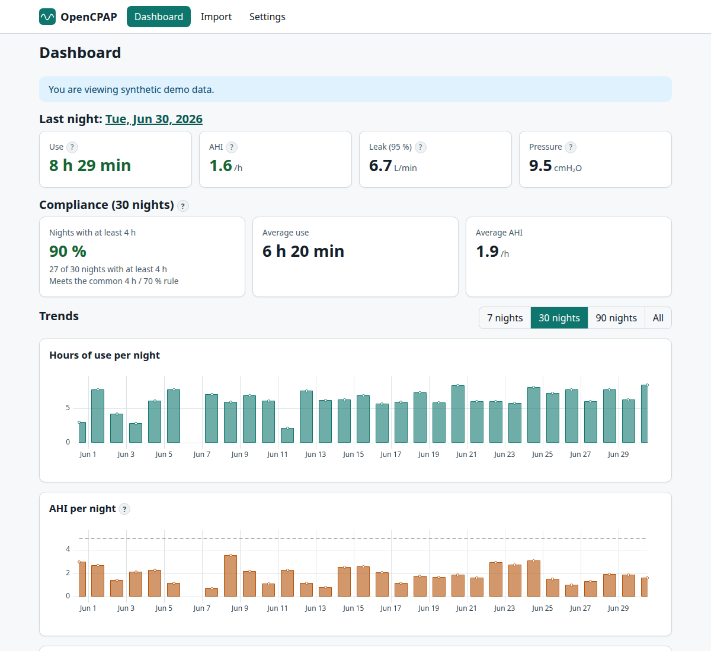
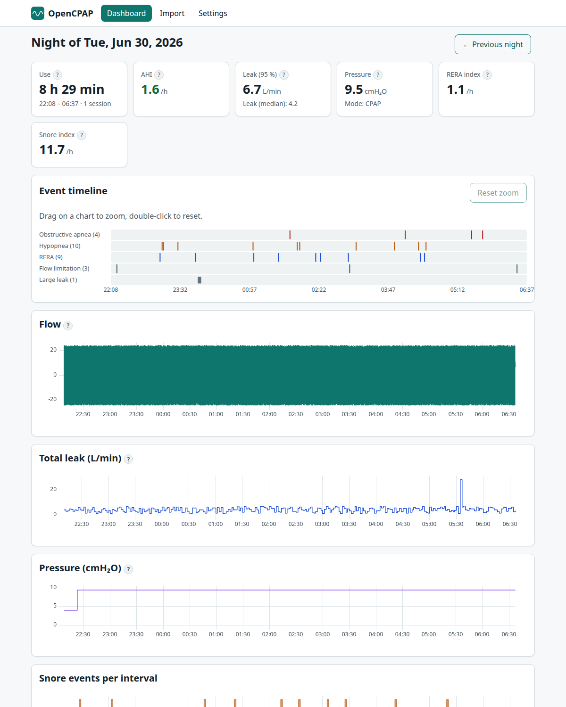

# OpenCPAP

A local-first web application for reading and visualizing the therapy data that a CPAP machine records on its SD card. The first supported device is the **Philips Respironics DreamStation 2**; the architecture is built so that other manufacturers (ResMed, Fisher & Paykel, BMC, Löwenstein, …) can be added as plugins.

> **Medical disclaimer.** OpenCPAP is an informational tool. It is not a medical device and does not provide medical advice, diagnosis or therapy recommendations. Discuss your data and any setting changes with your clinician.

## Principles

- **Privacy first.** All parsing and analysis runs in your browser. Your data is never uploaded unless you explicitly opt in to a future sharing feature.
- **Device-agnostic core.** Every device loader outputs the same canonical data model, so the UI and analytics never depend on a manufacturer's format.
- **Verified against OSCAR.** Parsers are validated against [OSCAR](https://www.sleepfiles.com/OSCAR/) results on the same SD card.
- **Open.** GPL-3.0-or-later.

## Status

| Phase | Scope | Status |
|---|---|---|
| 0 | Foundations, model, DS2 container decryption | Done (CI/lint pending) |
| 1 | DS2 chunk parser and data loader | Parser validated; browser import (folder/files/ZIP + Web Worker) done; OSCAR comparison and device-log files pending (see [roadmap](docs/roadmap.md)) |
| 2 | Web app: import, dashboard, night view, local storage, PWA, i18n, accessibility | Done (see [web-app.md](docs/web-app.md)); manual screen-reader and Firefox/Safari checks pending |
| 3–6 | Trends and reports, advanced analytics, multi-device, sharing | Planned |

## Supported devices

| Device | Detect | Decrypt | Parse | Notes |
|---|---|---|---|---|
| Philips DreamStation 2 | yes | yes | yes — sessions, settings, events, flow waveform, statistics | Verified on a 420X150C, firmware V1.0.6; other DS2 variants untested |

## Repository layout

```
packages/core/                 canonical model, VirtualFS, DeviceLoader interface
packages/loaders/philips-ds2/  DreamStation 2 loader (decryption, chunk parsing, sessions)
packages/browser/              card sources (folder, files, ZIP), Web Worker import pipeline
apps/web/                      the web app (React + Vite PWA)
e2e/                           Playwright end-to-end and accessibility tests
scripts/                       developer tools (OSCAR comparison)
docs/                          documentation (start with docs/architecture.md)
fixtures/raw/                  real SD data, git-ignored, never committed
```

## Screenshots



*(Synthetic demo data.)* Try it without a card: **Import → Load demo data**.

## Quick start

```bash
npm install
npm run dev        # web app on http://localhost:5173
npx tsc -b         # type-check
npx vitest run     # unit and integration tests
npm run e2e        # build + end-to-end and accessibility tests in Chrome
```

Requires Node.js 20+ (developed on Node 24) and, for the E2E tests, Google Chrome. See [docs/development.md](docs/development.md) and [docs/testing.md](docs/testing.md).

## Using it
1. Open the app, go to **Import** and choose the SD card's folder (the one that contains `P-SERIES`), drop it, or pick a ZIP of it.
2. Browse the **Dashboard** and open any **night** for the timeline and waveforms.
3. Everything stays in your browser. **Settings** lets you change language/theme and delete all stored data.

## Documentation index

- [Architecture](docs/architecture.md)
- [Web application (screens, charts, i18n, a11y, PWA)](docs/web-app.md)
- [Browser import (card sources, worker protocol)](docs/browser-import.md)
- [Local storage (IndexedDB schema)](docs/storage.md)
- [Analytics definitions (nights, AHI, leak, pressure, compliance)](docs/analytics.md)
- [Testing strategy](docs/testing.md)
- [Comparing with OSCAR](docs/oscar-comparison.md)
- [Canonical data model](docs/data-model.md)
- [DreamStation 2 file format](docs/formats/ds2.md)
- [Roadmap](docs/roadmap.md)
- [Feature catalog and idea origins](docs/features.md)
- [Privacy and security](docs/privacy-and-security.md)
- [Development guide](docs/development.md)
- [Contributing](CONTRIBUTING.md) · [Changelog](CHANGELOG.md)
- [Architecture decision records](docs/decisions/)

## License

GPL-3.0-or-later — see [LICENSE](LICENSE). Parts of the DreamStation 2 decoding logic are adapted from OSCAR's PRS1 loader (also GPLv3).
