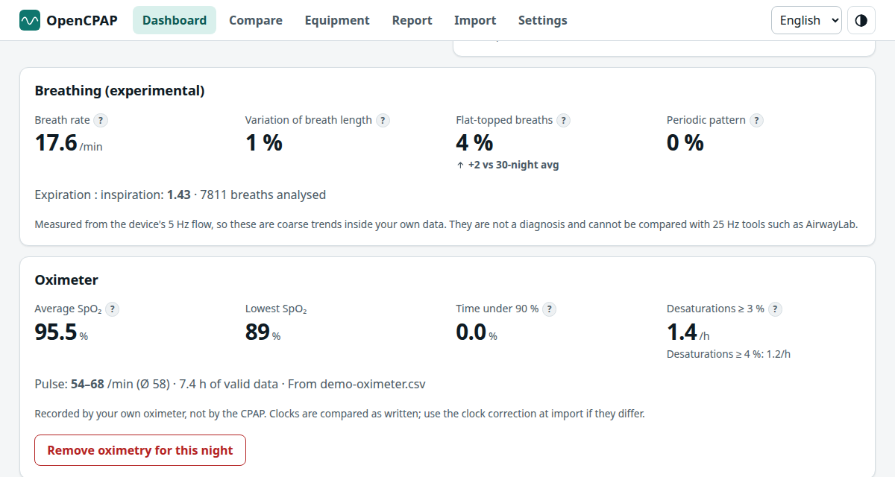

# Breathing analysis (experimental)

Code: `packages/core/src/breath.ts` (algorithm), `analysis.ts` (per session), `nights.ts` (`NightBreathing`), UI in `features/night/BreathingCard.tsx` and `features/dashboard/BreathingTrends.tsx`.

## What it is and what it is not
A breath-by-breath look at the flow waveform the DreamStation 2 stores: breath rate, how regular breathing is, how **flat-topped** the inspiratory flow is, and whether breath size waxes and wanes. It is **not** the Glasgow index and not a replacement for AirwayLab or for the device's own flow-limitation events.

Why it must stay modest:
- The DS2 records flow at **5 Hz** (about 15 samples per breath, 6–7 per inspiration). Tools such as AirwayLab work on 25 Hz data and compute eight shape features; at 5 Hz most of that detail does not exist.
- The **unit of the flow samples is not verified** (OSCAR calls it L/min with gain 1, but no calibration is published). The analysis is therefore **scale-free**: it uses times, ratios and coefficients of variation, never absolute flow or volume.
- Flow samples are kept by the card only for recent nights (about nine months on the sample card, from January 2026).

Everything is shown as *trends within your own data*, with a note in the UI saying so.

## Signal conventions (verified on the sample card)
Positive flow is inspiration. In the real signal the positive phase rises smoothly and **ends abruptly** in the negative expiratory peak, which then decays back to zero over about 8 samples; that shape (and the fact that the expiratory phase is longer, I:E ≈ 1.3) fixes the sign. 17.6 breaths per minute is typical for the sample card.

## Algorithm (`detectBreaths`)
1. Work per **contiguous segment** of flow (gaps never create fake breaths); segments shorter than 2 min are skipped.
2. Remove the slow baseline with a ~15 s moving mean (leak drift).
3. Robust amplitude = 90th percentile of |x|; below 3 raw counts the segment is treated as noise (no breaths).
4. State machine with a dead band of 8 % of the amplitude: *inspiration* when x > +band, *expiration* when x < −band; one breath per inspiration onset.
5. Reject artefacts: period outside 1.5–12 s, inspiratory time outside 0.4–6 s, peak below 25 % of the amplitude.
6. Per breath: `Ti`, `Te`, peak inspiratory flow, **shape = mean inspiratory flow / peak** (≈ 0.64 for a sine, → 1 for a plateau), and an inspiratory volume in arbitrary units.

Night figures (`summarizeBreaths`, aggregated by breath count across sessions):
| Figure | Definition |
|---|---|
| Breath rate | 60 / median breath period. Quantised at 5 Hz (one sample = 0.2 s): roughly ±1 breath/min at 24/min |
| Variation of breath length | coefficient of variation of the breath period |
| Flat-topped breaths | share of breaths with shape ≥ **0.80** (`FLAT_SHAPE`) |
| Expiration : inspiration | median Te / median Ti |
| Periodic pattern | share of 6-minute windows where the autocorrelation of the (2 s resampled) inspiratory volumes has a peak ≥ 0.5 at a lag of 20–120 s and the volumes vary by > 25 % |
| Window series (5 min) | the same figures per window, plotted as two tracks on the night |

The analysis runs in the **import worker** (about 25 ms per night) and is stored with the session; sessions imported before this feature existed are analysed in the background the first time the app opens (`Repository.backfillAnalysis`, versioned by `ANALYSIS_VERSION`).

## Validation
**Synthetic signals** (`breath.test.ts`): rate recovered within quantisation, rounded vs flat-topped shapes separated, scale invariance, baseline drift, noise and flat lines produce nothing, irregular breathing has a high variation, a 60 s amplitude modulation is detected as periodic and steady breathing is not.

**Sample card, 306 sessions with flow, 1 661 845 breaths** (about 8 s of computation in total):
| Check | Result |
|---|---|
| Breaths per hour of flow | median 1 057 (p5–p95: 859–1 181), i.e. ≈ 17.6/min — plausible |
| Breath rate per night | p5–p95 15.8–20.0 /min |
| Inspiratory time | median 1.4 s (resolution 0.2 s); I:E ≈ 1.29 |
| **Flat-topped share against the device's own events** (breaths in the 60 s *before* an event): | baseline (all breaths) **11.3 %**; before a device-flagged **flow limitation 31.1 %** (n = 592 breaths); before **RERA 18.5 %**; before **hypopnea 15.7 %**; before **obstructive apnea 11.0 %** |

So the flat-topped share is about **2.7× higher before the device's flow-limitation events** and rises in the expected order (flow limitation > RERA > hypopnea > obstructive apnea, which is not a partial narrowing and serves as a control). It is independent evidence that the measure carries real information, but modest: 31 % is not 100 %, the number of flow-limitation events is small, and no threshold has been tuned beyond choosing 0.80.

**Periodic pattern: not validated on real data.** On the sample card the device reports periodic breathing in only 7 sessions, for 3–7 minutes each, shorter than the 6-minute window. In those sessions the measure reads about 0.01, the same as in the 278 sessions without any device-reported periodic breathing (median 0.007): **no false positives, but no sensitivity to brief episodes.** It is meant for sustained patterns and says so in the UI. The device's own events are the reference.

## Using the numbers
- Compare a night with your own recent nights (the card shows the change versus the 30-night average and a finding appears when the flat-topped share is ≥ 1.5× your usual and ≥ 20 %).
- Do not compare with other people's numbers or with 25 Hz tools.
- They are not a diagnosis. If you are concerned, talk to your clinician.

## Improving it later
- Calibrate `FLAT_SHAPE` and the dead band on more cards (and on other devices when loaders exist); a second source of ground truth (OSCAR's exported flow-limitation values, or a 25 Hz device) would allow a proper ROC.
- Add an inspiratory-shape feature that is robust at 5 Hz (for example the ratio of flow at 25 / 75 % of Ti), and test it against the same device events.
- Validate the periodic-pattern window on a night with long periodic breathing.
