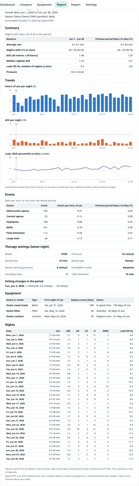

# Therapy report (print / PDF)

Route `#/report`. Code: `apps/web/src/features/report/` (`ReportPage` options, `ReportDocument` content, `SvgCharts` figures) and the `@media print` block of `styles.css`.

## Why print-to-PDF
The report is a normal HTML page with a print stylesheet; the user chooses **Print or save as PDF** and the browser produces the file (the dialog's "Save as PDF"). This keeps the app free of a PDF library, produces a real text-based PDF (searchable, accessible, small), uses the system fonts, and works offline. The trade-off is that the page breaks are decided by the browser; the stylesheet avoids splitting tables rows, figures and sections.

## Options (not printed)
- **Period**: last 30 nights, last 90 nights, all data, or custom dates (the Compare page's "Open a report for period B" link opens a custom period).
- **Name (optional)**: printed on the report only; remembered in this browser's `localStorage`, never in the database or a backup.
- **Compare with the previous period** (same length immediately before) — on by default.
- **Include equipment** — on. **Include the table of every night** — on.
- **Include my notes and tags** — **off by default**: notes are private and are only printed when the user opts in.

## Contents, in order
1. Title, period, patient name (if given), device model(s) (no serial number), generation date.
2. **Summary**: average use, nights with ≥ 4 h (count and %), AHI (all events / all hours), median nightly AHI, median 95 % leak, configured pressure; with the previous period alongside when enabled. The table has fixed column widths so that measure names and figures stay on one line in A4. A **Reference** column gives the reference for each measure, with a three-state status where a range exists (a plain-text status: the icon carries the colour, the words stay in black, so the figures keep the visual weight; the median AHI row shows the status only, as the AHI row above gives the text), and a footnote says the references are orientative (see [reference-ranges.md](reference-ranges.md)). When the period has them, one line each for **oximetry** (nights with data, average and lowest SpO₂, median time under 90 %, mean desaturations ≥ 3 % per hour) and **breathing** (nights with flow, median breath rate, median flat-topped share, median variation of breath length; labelled experimental).
3. **Trends**: three static SVG figures — hours of use (reference at 4 h), AHI (reference at 5/h), 95 % leak — with dashed markers on nights when a therapy setting changed.
4. **Events**: counts and rates per hour of use by type, previous period alongside.
5. **Therapy settings** of the latest night and **setting changes** within the period (before → after).
6. **Equipment**: items in use with age, interval and status as of the latest data.
7. **Notes** (opt-in): date, mood, tags, text.
8. **Nights**: compact table of every night (use, AHI, OA, CA, H, RERA, 95 % leak).
9. Footer: limits of the figures and the medical disclaimer.

## Print behaviour
- The stylesheet forces the **light palette** even if the screen is in dark mode and hides the header, footer and option panel (`.no-print`).
- A4 with 14 mm margins (`@page`), `print-color-adjust: exact` so bars and markers keep their colours, table headers repeat across pages, rows and figures do not split.
- Figures are inline SVG (`SvgCharts.tsx`), not canvas, so they stay sharp at any zoom and in the PDF.
- Numbers come from `periodStats` in `@opencpap/core`, the same functions as the Compare page and the dashboard, so the report always agrees with the app.

## Verification
`e2e/phase3.e2e.ts` renders the page to a PDF with Chrome and checks it with `pdfinfo`/`pdftotext`: it is a valid PDF with at least one page, contains the title, the patient name, the section headings and the setting-change text, **does not** contain the navigation, the device serial number, or the private notes (until "Include my notes" is ticked — then it does). The test runs with the app in dark mode to prove the print palette is light.

## Limits / follow-ups
- The report is as accurate as the device's own records; leak is *total* leak (it includes the mask's intentional vent flow) and the footer says so.
- No signature block, patient date of birth or clinic logo yet; add them as optional fields if clinicians ask.
- Page numbers are not printed (browser headers/footers can be switched on in the print dialog).
- The references in the Reference column have no cited sources yet; they are marked as orientative in the footnote ([reference-ranges.md](reference-ranges.md)).
