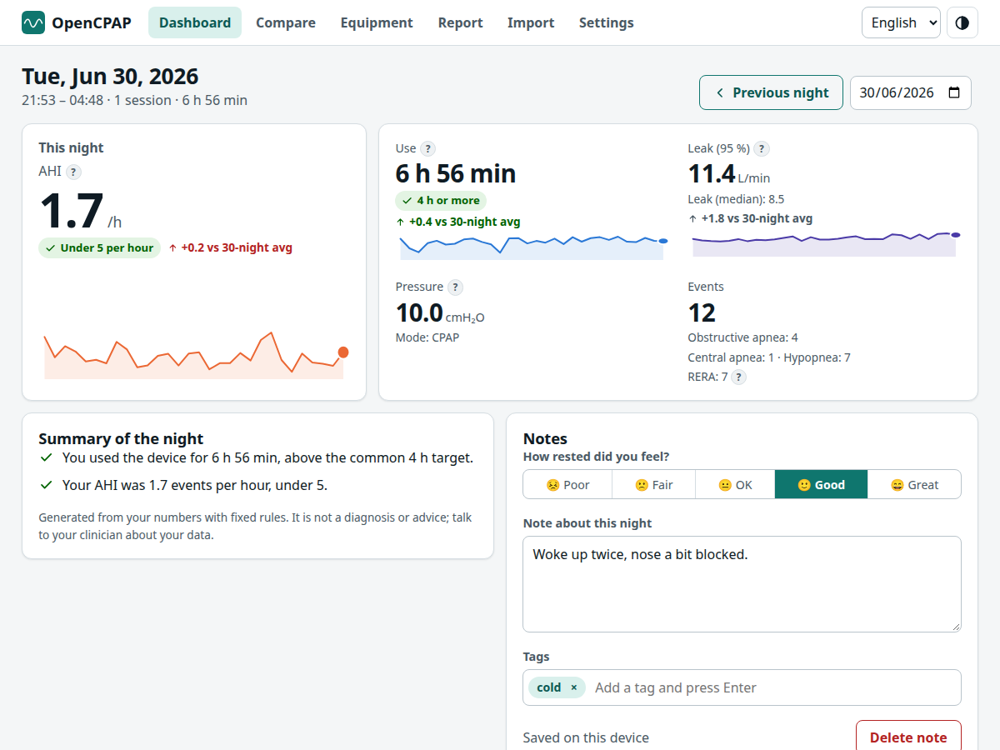
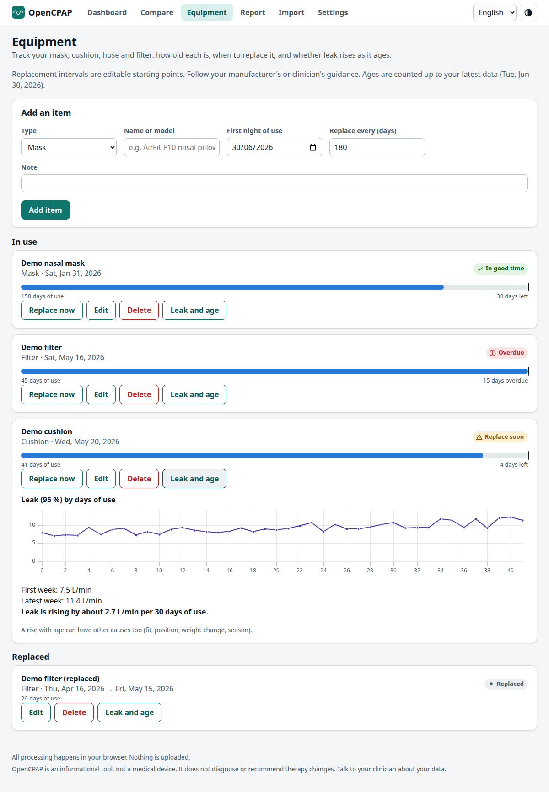
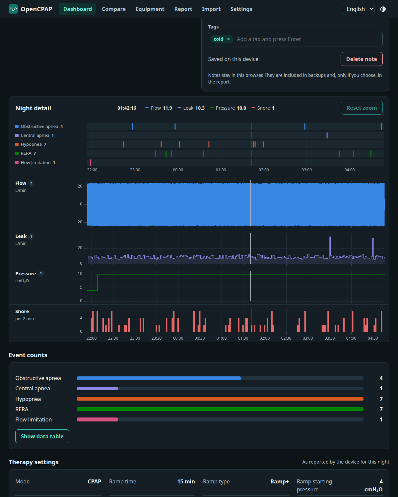
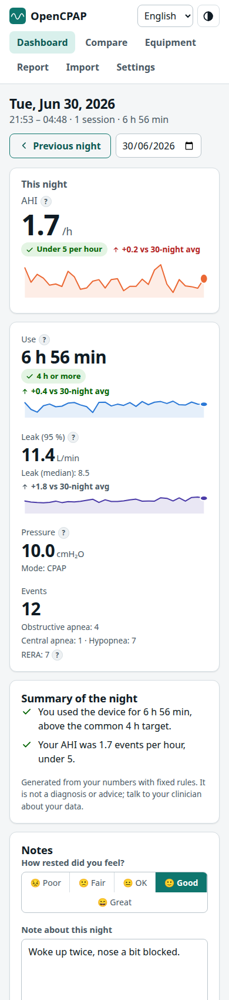

# Web application (`apps/web`)

A React + TypeScript single-page app, built with Vite, that is also an installable PWA. Everything runs in the browser: parsing in a Web Worker ([browser-import.md](browser-import.md)), storage in IndexedDB ([storage.md](storage.md)), charts on canvas.








*(Screenshots use synthetic demo data.)* The visual language is documented in [design-system.md](design-system.md).

## Running it
```bash
npm install
npm run dev          # Vite dev server with HMR (http://localhost:5173)
npm run build        # type-check + production build into apps/web/dist
npm run preview      # serve the production build (http://localhost:4173), needed by the E2E tests
```
Requirements: Node 20+. For import from the card the browser must be able to read a folder (any browser via the folder input; Chromium also offers the File System Access picker) or a ZIP file.

## Screens

| Route | Screen | What it shows |
|---|---|---|
| `#/` | **Dashboard** | *Last night* hero (AHI as the large figure with a status chip, change versus the 30-night average and a sparkline) with tiles for use, 95 % leak (each with sparkline and change), pressure and events; a **compliance meter** (target marker at 70 %); **trend charts** (hours of use, AHI with a 5/h reference line, 95 % leak) for 7/30/90 nights or all; a **calendar** with one cell per night coloured by use, AHI or leak; and a **nights table** with mini bars and warning icons |
| `#/night/YYYY-MM-DD` | **Night** | The same hero for that night, then **Night detail**: an event timeline and flow, leak, pressure and snore tracks on one aligned time axis with linked zoom and a shared readout; event counts as bars (with an optional full event table); and the **therapy settings** reported by the device (mode, ramp, pressure relief, humidifier, tube, mask resistance, auto start/stop). Previous/next buttons and a date picker move between nights |
| `#/compare?a=…&b=…` | **Compare** | Two periods (date pickers, presets: last 30/90 nights vs the same number before, or around a setting change; swap A and B): a table of nights with data, average use, nights ≥ 4 h, AHI, median nightly AHI and leak with the change (B − A), events per hour as paired bars, the therapy settings of each period with differences highlighted, and the setting changes inside them. The URL carries both periods, so a comparison can be bookmarked or shared |
| `#/equipment` | **Equipment** | Add mask, cushion, headgear, hose, filter, humidifier chamber or other items with a first night of use and a replacement interval; each shows age, a progress meter against the interval, a status chip (in good time / replace soon / due / overdue), *Replace now* (retires the item and starts a new one), edit, delete, and a **Leak and age** panel (95 % leak against days of use with a plain-language trend) |
| `#/report?range=…` | **Report** | A printable summary for a clinician with options, then *Print or save as PDF* ([report.md](report.md)) |
| `#/import` | **Import** | Three numbered steps, folder picker (Chromium), folder input (any browser), ZIP input, drag & drop of a folder or ZIP, progress with cancel, detected device, clear errors, demo data loader |
| `#/settings` | **Settings** | Language, theme, stored data summary and browser storage usage, **backup download and restore** ([backup-format.md](backup-format.md)), **persistent-storage request**, per-device and global delete (also removes notes and equipment), privacy and about |

The **header** has the language selector and a theme button (system → light → dark) on every screen.

### Dashboard additions (Phase 3)
A **custom date range**; **equipment reminders** (only when something is due or overdue); **dashed markers with a flag** on the trend charts on nights when a setting changed (the tooltip names the change); a **Setting changes** list with a *Compare 30 nights before and after* link for each; and a note icon in the nights table for nights that have a note.

### Night additions (Phase 3)
A **Summary of the night** in plain language (rules in [analytics.md](analytics.md#plain-language-summary-nightfindings), one icon per sentence, disclaimer) next to **Notes**: mood (1–5), free text and tags with suggestions from tags used before. Notes save automatically 0.7 s after the last edit and show "Saved on this device"; an entry with nothing in it is removed.

Routing is hash-based (`router.ts`): it needs no server configuration and works from any static host and from the installed PWA.

## Behaviour worth knowing
- **Hover and click.** Dashboard charts show a tooltip (value first, then label) and clicking a bar or point opens that night; calendar cells are links. On a night, moving over any track updates one **readout** in the sticky header with the time and the value of flow, leak, pressure and snore, and a vertical cursor follows on every track and on the timeline.
- **Nights, not sessions.** The device may split one night into several sessions (mask taken off); the UI groups them into a *night* (noon-to-noon, see [analytics.md](analytics.md)).
- **Linked zoom.** Dragging on any night track zooms all tracks and the timeline; double-click or *Reset zoom* restores the full night. All tracks share one x domain, so they line up at every zoom level.
- **Mask-off periods** are shaded on the charts and on the timeline.
- **Missing detail.** Nights for which the card kept no flow data still show summary statistics and a notice instead of the flow chart.
- **Metric explainers.** Every key figure has a `?` button with a plain-language explanation (`explain.*` strings), including a reminder that targets are for the clinician to decide.
- **Demo mode.** *Load demo data* generates 75 synthetic nights (`generateDemoSessions`) under a fictitious "Demo" device, with a story so every feature has something to show: the pressure is raised once, the leak creeps up as a cushion ages, and there is a demo mask, cushion, filter and three notes. A banner tells the user, and *Remove demo data* deletes the demo device, the demo equipment (ids starting `demo-`) and the demo notes (tag `demo`) without touching real data.
- **Idempotent imports.** Importing the same card again replaces sessions with the same device and id; nothing is duplicated.

## Source layout (`apps/web/src`)
| Path | Responsibility |
|---|---|
| `main.tsx`, `App.tsx` | Bootstrapping (i18n, theme, service worker) and the page shell with navigation |
| `router.ts` | Hash router (`parseRoute`, `href`, `useRoute`) |
| `state.tsx` | `DataProvider`/`useData`: night summaries and devices loaded from the repository, `reload()` after changes |
| `db/` | Dexie schema (`db.ts`), the `Repository` data-access layer (`repository.ts`) and the backup codec (`backup.ts`) |
| `features/import/` | `ImportPanel`, `importService` (worker import → database, demo data, folder drop traversal) |
| `features/dashboard/` | `Dashboard`, `Hero`, `TrendCharts`, `CalendarHeatmap`, `NightsTable`, `metrics` (status bands, baseline, heat scale, calendar maths) |
| `features/night/` | `NightView`, `Timeline` (SVG rows, nice ticks), `nightData` (model → chart arrays, cursor readout lookups), `settingsRows` |
| `features/changes/` | `ChangesPanel`, `format` (setting labels and values with units) |
| `features/compare/` | `ComparePage` |
| `features/equipment/` | `EquipmentPage`, `LeakAgeChart`, `Reminders` |
| `features/report/` | `ReportPage`, `ReportDocument`, `SvgCharts` |
| `features/settings/` | `Settings` (language, theme, backup, storage, deletion) |
| `components/` | `Chart` (uPlot wrapper), `chartTooltip`, `axes` (locale-aware labels), `Header`, `Badge`, `Delta`, `Sparkline`, `Meter`, `InfoTip`, `icons` |
| `i18n/` | i18next setup and the three locale files |
| `format.ts`, `color.ts`, `theme.ts`, `styles.css` | Formatting, colour maths (mix, contrast, heat ramp), theme handling, design tokens |

## Charts
`components/Chart.tsx` wraps [uPlot](https://github.com/leeoniya/uPlot) (canvas, handles hundreds of thousands of points). It
- rebuilds when the theme changes (canvas cannot follow CSS variables), reading colours from the design tokens,
- resizes with its container (`ResizeObserver`),
- shares an x range between charts (`domain`, `range`/`onRangeChange`) and a crosshair sync key,
- reports the pointer position (`onCursor`) and clicks (`onPointClick`), and can disable zoom,
- shows the vertical cursor only (no horizontal line),
- exposes an `aria-label`, and the page offers equivalent tables (nights table, event counts, event table).

Timestamps are device wall-clock encoded as UTC, so all time axes use `tzDate` = UTC and locale formatting via `Intl` with `timeZone: 'UTC'` (24 h clock for Catalan/Spanish, 12 h for English).

## Internationalisation
`i18next` + `react-i18next`, languages `en`, `ca`, `es`. The language is the saved choice, else the browser language, else English; it also sets `<html lang>`. Plural forms use i18next suffixes (`_one`/`_other`). Unit tests guarantee all locales have identical keys and interpolation placeholders. To add a language: add `locales/<code>.json` (copy `en.json`), register it in `i18n/index.ts` (`LANGUAGES`, `resources`), and the parity test will list anything missing.

## Theming
Design tokens are CSS variables in `styles.css`. Light is the default; dark follows `prefers-color-scheme` unless the user chooses a theme explicitly (`data-theme` on `<html>`, stored in `localStorage`). Charts re-read the tokens when the theme changes.

## Accessibility
Semantic landmarks and headings, a skip link, visible focus rings, text/background pairs checked for WCAG AA, status and trend never conveyed by colour alone (icon + text), `aria-live` import status, native `<details>` for explainers, charts with accessible names and table alternatives, calendar cells as labelled links, reduced-motion support. The full checklist is in [design-system.md](design-system.md). Automated checks (axe, WCAG 2.1 A/AA) run on all main screens in light and dark themes in CI-style E2E tests. Manual screen-reader testing has **not** been done yet.

## PWA
`vite-plugin-pwa` (Workbox `generateSW`, auto-update) precaches the build (about 570 KiB, split into app, vendor and chart chunks so an app update does not invalidate cached libraries) so the app opens offline; the manifest provides name, icons (192/512 px PNG and SVG) and `display: standalone`. User data is never cached by the service worker, it lives in IndexedDB.

## Known limitations
- Hash routing means night links look like `#/night/2026-03-05`.
- The File System Access picker path (Chromium) and drag & drop are only exercised through unit fakes; E2E covers the folder input, ZIP, errors and persistence in real Chrome. Firefox/Safari are untested.
- Flow values are shown as reported (OSCAR calls them L/min); physical scaling is unverified ([formats/ds2.md](formats/ds2.md)).
- The report relies on the browser's print dialog; there is no one-click PDF download.
- Backups are not encrypted.
- The sticky *Night detail* header covers part of the viewport while scrolling the tracks; on phones it is static.
- The calendar is bounded by the selected range (7/30/90/all); the nights table lists every night in the range without virtualisation.
